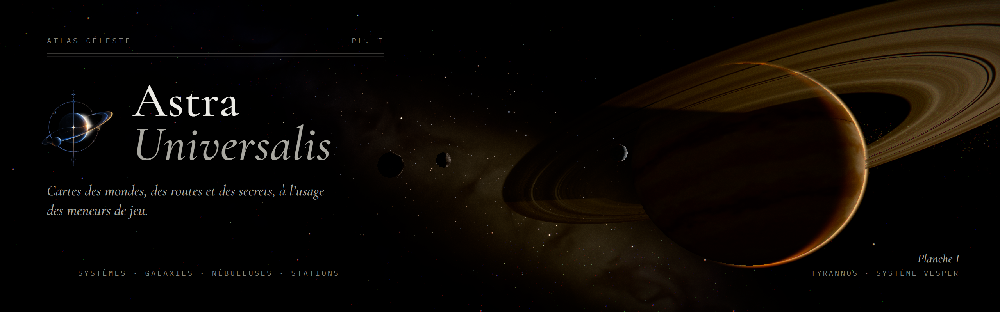

  

# Astra Universalis

Atelier de cartographie stellaire pour rôlistes : systèmes solaires, galaxies, nébuleuses, stations et
vaisseaux. Pensé pour **Mothership** et tous les jeux de science-fiction.

---

## Télécharger

Rendez-vous sur la page des [**versions**](https://github.com/YourHacktivist/Astra-Universalis/releases/latest)
et prenez l'un des deux fichiers :

| Fichier | Pour qui |
|---|---|
| **Astra-Universalis-Setup-x.y.z.exe** | Installateur : choix du dossier, raccourcis, ouverture des fichiers `.astra` par double-clic. |
| **Astra-Universalis-x.y.z-Portable.exe** | Version portable : aucune installation, double-cliquez et c'est parti. |

Au premier lancement, Windows SmartScreen peut afficher « Windows a protégé votre ordinateur », car
l'application n'est pas signée : cliquez sur **Informations complémentaires** puis **Exécuter quand même**.

### Configuration requise

- Windows 10 ou 11, 64 bits.
- Environ 400 Mo d'espace disque.
- Une carte graphique récente. Si l'affichage manque de fluidité, baissez la qualité de rendu (Basse,
  Moyenne, Haute, Ultra) dans le menu **Affichage** de la barre d'outils.

---

## Fonctionnalités

- **Astres** : étoiles O→M (sous-classes, géantes, supergéantes), naines brunes et blanches, étoiles à
  neutrons, pulsars, trous noirs à disque d'accrétion (lentille gravitationnelle, effet Doppler), ajoutables
  directement depuis le menu Ajouter ; barycentres pour les systèmes multiples.
- **Planètes & lunes** : 15 types (tellurique, océan, jungle, désert, aride, glace, lave, stérile, toxique,
  géantes gazeuses et de glace, Jupiter chaud, chthonienne, œcuménopole, exotique) avec textures
  procédurales : relief érodé et chaînes de montagnes, biomes selon le climat, océans à reflet solaire
  ondulé, nuages en volume (cyclones, cumulus, cirrus) aux ombres portées, atmosphère, lumières nocturnes,
  anneaux ombrés. En gros plan, un détail procédural prend le relais et l'astre observé est affiné en
  haute résolution.
- **Petits corps** : ceintures d'astéroïdes et de Kuiper (milliers de rochers cratérisés animés), disques
  de débris, nébuleuses et nuages de gaz, comètes (noyau sombre et glacé, queues ionique et de poussière).
- **Artificiels** : stations (anneau, modulaire, cylindre d'O'Neill, avant-poste, chantier, raffinerie,
  épave), vaisseaux, portails de saut, marqueurs (détresse, épave, anomalie, danger…), routes animées.
  Coques détaillées : plaques et joints, salissures, bandes de danger, panneaux solaires, brûlures sur
  les épaves.
- **Mécanique** : orbites képlériennes complètes (a, e, i, Ω, ω, M₀), périodes automatiques (3ᵉ loi de
  Kepler), rotation, inclinaison de l'axe, verrouillage par effet de marée, points de Lagrange.
- **Lisibilité** : échelles linéaire / compressée / logarithmique, axes, équateurs, grille écliptique,
  zone habitable, ligne des glaces, étiquettes intelligentes.
- **Styles de rendu** : Cinématique, Terminal (phosphore ambre façon écran cathodique) et Plan (tracé
  technique).
- **Manipulation directe** : glissez un astre dans la vue 3D pour changer son orbite (Maj + glisser, ou
  outil Déplacer `M`) ; renommage partout (F2, double-clic, clic droit, inspecteur).
- **Mode immersif** (`I`) : plein écran sans interface, dérive cinématique de la caméra, bandeau
  documentaire de l'astre suivi, bandes cinéma. Idéal pour projeter en partie.
- **Frise du temps** : glisser pour remonter ou avancer le temps, molette pour zoomer, flèches au clavier.
- **Outils de jeu** : notes MJ par astre, mode joueurs (masque les secrets), calculateur de trajet
  (accélération constante, délai de communication), générateur procédural à graine.
- **Accessibilité** : contrastes conformes WCAG AA, focus visible à deux tons, arbre navigable au clavier
  (flèches, Entrée, F2), respect de « réduire les animations » (vols de caméra instantanés, pas de dérive).
- **Galaxie** : galaxie procédurale, systèmes, routes de saut, régions.
- **Fiche système** imprimable (thèmes Atlas et Impression).
- **Export image** jusqu'à 8K, recadrages (16:9, A4…), étiquettes vectorielles, cartouche titre.

## Raccourcis principaux

| Raccourci | Action |
|---|---|
| Ctrl+N / Ctrl+O / Ctrl+S | Nouveau / Ouvrir / Enregistrer |
| Ctrl+Z / Ctrl+Y | Annuler / Rétablir |
| Ctrl+K | Palette de commandes |
| Ctrl+E | Exporter une image |
| Ctrl+G | Générateur de système |
| F / H | Centrer sur la sélection / Cadrer tout |
| I | Mode immersif |
| M · Maj + glisser | Déplacer un astre |
| F2 | Renommer la sélection |
| 1 · 2 · 3 | Vue de dessus · profil · trois-quarts |
| Espace, + / − | Lecture / pause, vitesse du temps |
| Ctrl+Maj+P | Mode joueurs |

## Vos projets

Chaque projet s'enregistre dans un fichier `.astra`, à ranger où vous voulez et à partager avec
d'autres MJ. Un projet que vous n'avez pas encore enregistré n'est pas perdu à la fermeture : il est
gardé en brouillon, à retrouver dans le registre de l'écran d'accueil (les fichiers sont dans
`%APPDATA%\Astra Universalis\Brouillons`).
